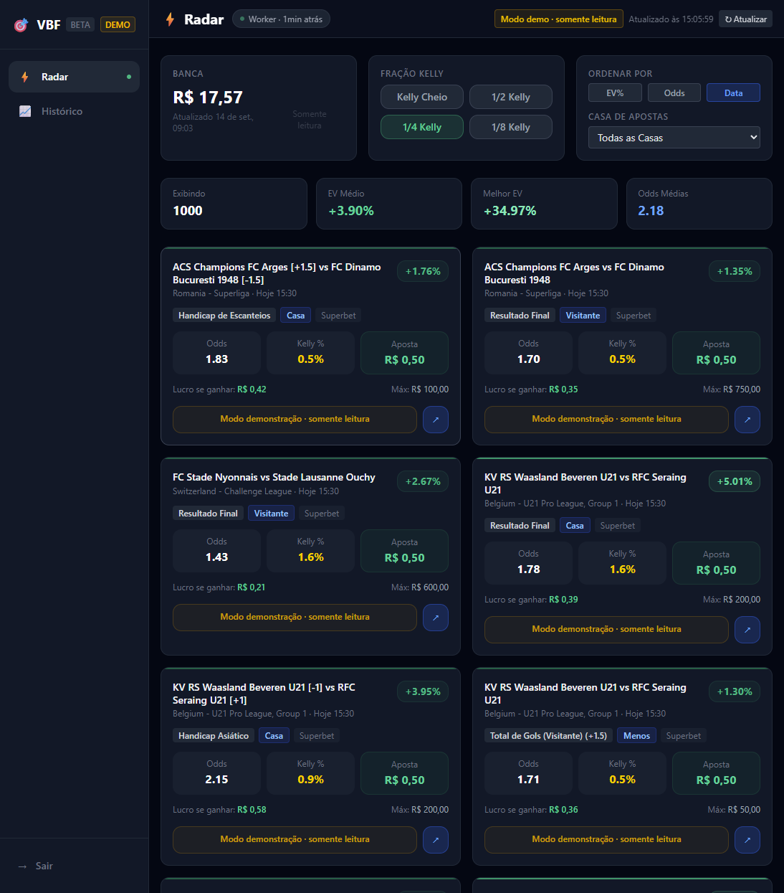
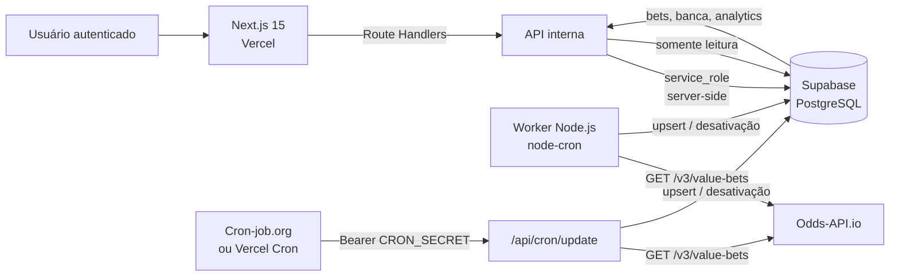

<div align="center">


# Value Bet Finder (VBF)

**Radar de value bets, gestão de banca e analytics — um projeto de estudo full-stack.**

[](https://nextjs.org/)
[](https://react.dev/)
[](https://www.typescriptlang.org/)
[](https://tailwindcss.com/)
[](https://supabase.com/)
[](https://authjs.dev/)
[](https://nodejs.org/)
[](https://vitest.dev/)
[](https://vercel.com/)
[](LICENSE)

[🌐 Demo](https://valuebetfinder.vercel.app) ·
[✨ Funcionalidades](#-funcionalidades) ·
[🏗️ Arquitetura](#️-arquitetura) ·
[🚀 Rodando localmente](#-rodando-localmente) ·
[📚 Índice](#-índice)

</div>

---

> [!WARNING]
> **Apostas de quota fixa estão proibidas no Brasil.**
> A Medida Provisória nº 1.394/2026, de 25 de setembro de 2026, proibiu a exploração, oferta, intermediação e publicidade das apostas de quota fixa (as “bets”) no país. As plataformas deixaram de funcionar em 6 de outubro de 2026. A MP está em vigor e aguarda apreciação do Congresso Nacional. Este repositório é um estudo técnico e **não opera, intermedia, divulga ou promove apostas**.

## 📌 Sobre o projeto

O **Value Bet Finder (VBF)** é uma aplicação full-stack single-admin, com uma conta de demonstração somente leitura, para **descobrir, registrar e analisar value bets** em futebol. O projeto nasceu como um estudo prático de engenharia de software, integração de APIs, modelagem de dados, autenticação, estatística aplicada e visualização de dados — e não como um produto de apostas.

A aplicação consome o endpoint `/v3/value-bets` do [Odds-API.io](https://odds-api.io/) para duas casas de apostas (Superbet e Bet7k), persiste as oportunidades no Supabase, calcula o stake sugerido com o **critério de Kelly fracionado** e permite acompanhar banca, resultados e métricas de desempenho ao longo do tempo.

> **Acesso de demonstração**
>
> | Perfil | Usuário | Senha | Permissões |
> | --- | --- | --- | --- |
> | Demonstração | `demo` | `demo-value-bets` | Somente leitura |
> | Administrador | `ADMIN_USERNAME` | `ADMIN_PASSWORD` | Completo |
>
> A conta `demo` é habilitada por padrão e permite navegar pelo radar, histórico, banca e analytics. Ela **não** pode forçar buscas, editar a banca ou resolver apostas — as rotas de escrita retornam `403` para esse perfil. No modo demo, a interface também não inicia polling automático nem exibe os botões de atualização manual e de busca forçada. Para alterar as credenciais, defina `DEMO_USERNAME`/`DEMO_PASSWORD`; para desativar, use `DEMO_ENABLED=false`.
>
> Para testar localmente como administrador, defina `ADMIN_USERNAME` e `ADMIN_PASSWORD` no seu `.env`.

**Domínio canônico:** [valuebetfinder.vercel.app](https://valuebetfinder.vercel.app)

<p align="center">
  
</p>

## 📚 Índice

- [Sobre o projeto](#-sobre-o-projeto)
- [Funcionalidades](#-funcionalidades)
- [O que este projeto demonstra](#-o-que-este-projeto-demonstra)
- [Stack e ferramentas](#️-stack-e-ferramentas)
- [Arquitetura](#️-arquitetura)
- [A parte estatística](#-a-parte-estatística)
- [Segurança](#-segurança)
- [Rodando localmente](#-rodando-localmente)
- [Deploy na Vercel](#️-deploy-na-vercel)
- [Banco de dados](#️-banco-de-dados)
- [API](#-api)
- [Estrutura do projeto](#-estrutura-do-projeto)
- [Testes](#-testes)
- [Decisões técnicas e trade-offs](#-decisões-técnicas-e-trade-offs)
- [Possíveis melhorias futuras](#-possíveis-melhorias-futuras)
- [Aviso importante](#️-aviso-importante--projeto-de-estudo)
- [Autor](#autor)
- [Licença](#-licença)

---

## ✨ Funcionalidades

### Radar de value bets

- Lista de value bets ativas vindas do banco, com EV, odds, mercado, lado da aposta e casa.
- Ordenação por EV, odds ou data do evento.
- Filtro por casa de apostas.
- Seleção da fração de Kelly: **Kelly cheio, 1/2, 1/4 (padrão) e 1/8**.
- Cálculo de stake recomendado, lucro potencial e stake máxima informada pela casa.
- Tradução de mercados e lados de aposta para português (ex.: `ML` → `Resultado Final`, `over` → `Acima`).
- Exibição de handicap quando o mercado é de spread/handicap.
- Atualização automática da lista a cada 60 segundos **somente para o administrador**; o modo demo não faz polling.
- Botão de **busca manual** para forçar um ciclo de ingestão — visível apenas para o administrador.
- Badge de status do worker com última execução, erros e total de apostas salvas.

### Gestão de banca

- Banca editável com validação de valor positivo — restrito ao administrador.
- Registro auditável de transações no banco (`deposit`, `withdrawal`, `win`, `loss`, `adjustment`).
- Atualização automática da banca ao resolver uma aposta.

### Histórico e analytics

- Visão geral com total de apostas, acertos, erros, taxa de acerto, lucro/prejuízo, ROI e EV gerado.
- Gráfico de **lucro/prejuízo acumulado** em SVG.
- Tabela diária com apostas, acertos, taxa, valor apostado, P/L e EV.
- Aba com todas as apostas e filtros por status (`won`, `lost`, `void`, `pending_result`).
- Resolução manual de apostas: **ganhou**, **perdeu** ou **void** — restrita ao administrador.

### Ingestão e operação

- Worker Node.js independente com `node-cron` para atualizações a cada 40 segundos.
- Endpoint `/api/cron/update` para execução em ambientes serverless, protegido por segredo.
- **Cron job externo no [cron-job.org](https://cron-job.org) mantém a ingestão ativa em produção.**
- Rate limit de 90 segundos no endpoint de cron para proteger a cota da API.
- Upsert idempotente por `id` da value bet.
- Desativação automática de apostas que desapareceram do feed do provedor.
- Marcação automática de apostas vencidas como `pending_result`.

### Segurança e experiência

- Login com Auth.js/NextAuth v5 (estratégia JWT, sessão de 24 horas).
- Dois perfis: administrador (variáveis de ambiente) e demonstração somente leitura.
- Escritas bloqueadas no servidor para o perfil demo (`403`), não apenas escondidas na interface.
- Modo demo sem polling e sem botões de atualização manual ou busca forçada.
- Endpoint de cron autorizado apenas pelo `CRON_SECRET`, com comparação timing-safe; sessão de usuário não autoriza ingestão.
- Rotas de dados protegidas por sessão.
- Validação de payloads com Zod.
- Row Level Security (RLS) habilitado no Supabase.
- Chave `service_role` usada apenas no servidor.
- Layout dark, responsivo, com navegação lateral no desktop e barra inferior no mobile.

---

## 🧠 O que este projeto demonstra

Este repositório foi organizado para evidenciar competências técnicas além da interface:

- **Full-stack com Next.js App Router:** Server Components, layouts aninhados, Route Handlers, middleware de autenticação e metadata por rota.
- **TypeScript em modo estrito:** tipos compartilhados entre frontend, API, banco e worker.
- **Modelagem relacional:** tabelas normalizadas, índices, chaves estrangeiras, constraints, seed e migrations idempotentes.
- **Integração com API de terceiros:** cliente HTTP com timeout, tratamento de erros, normalização de payload e estratégia de rate limit.
- **Estatística aplicada:** probabilidade implícita, expected value (EV), critério de Kelly fracionado, ROI, taxa de acerto e P/L acumulado.
- **Segurança:** autenticação JWT, autorização por perfil, segregação de chaves, RLS, validação de entrada, endpoint de cron com segredo e ausência de segredos no repositório.
- **Testes automatizados:** Vitest + Testing Library, com testes de cálculo, parsing, mapeamento de banco, lógica de worker, autorização de rotas e componentes.
- **DevOps:** deploy na Vercel, banco no Supabase, worker em processo separado e cron externo no cron-job.org.
- **Documentação:** README detalhado, licença MIT, política de segurança, schema SQL e migrations versionadas.
- **Produto e UX:** fluxo completo de descoberta → decisão → registro → resolução → análise, com estados de loading, erro e vazio.

---

## 🛠️ Stack e ferramentas

| Camada | Tecnologias |
| --- | --- |
| **Frontend** | Next.js 15 (App Router), React 18, TypeScript 5, Tailwind CSS 3 |
| **Backend** | Route Handlers do Next.js, Zod, Auth.js/NextAuth v5 |
| **Banco de dados** | Supabase (PostgreSQL), SQL, RLS, migrations versionadas |
| **Ingestão de dados** | Odds-API.io, Axios, Node.js, node-cron |
| **Testes** | Vitest, Testing Library, jsdom |
| **Deploy** | Vercel (aplicação), Supabase (banco) e cron-job.org (agendamento) |
| **Qualidade** | ESLint, TypeScript strict, `npm audit`, Vitest coverage |

### Dependências principais

- `next` — framework full-stack e roteamento.
- `react` / `react-dom` — interface.
- `@supabase/supabase-js` — acesso ao PostgreSQL via Supabase.
- `next-auth` — autenticação com credenciais e sessão JWT.
- `zod` — validação de schemas e payloads.
- `axios` — cliente HTTP para a Odds-API.
- `node-cron` — agendamento do worker.
- `tsx` — execução de TypeScript no worker e em scripts.
- `vitest` / `@testing-library/react` — testes unitários e de componentes.

---

## 🏗️ Arquitetura



### Fluxo de dados

1. O **worker** (ou o endpoint de cron) consulta a Odds-API para cada casa configurada.
2. O payload é normalizado para o modelo interno (`ValueBet`).
3. As apostas são gravadas com **upsert idempotente** por `id`.
4. Apostas que não vieram mais no feed são marcadas como `inactive`.
5. O frontend **nunca chama a Odds-API diretamente**: ele lê apenas do banco através das rotas internas.
6. Ao resolver uma aposta, o sistema atualiza `value_bets`, `bankroll` e `bankroll_transactions`.
7. Os analytics são derivados das apostas resolvidas (`won`, `lost`, `void`).

### Por que um worker separado?

O worker precisa rodar continuamente a cada 40 segundos. Esse modelo não é adequado para funções serverless de vida curta, então ele é mantido como um processo Node independente. Para deploy somente na Vercel, a alternativa é usar o endpoint `/api/cron/update` com um agendador externo — em produção, o projeto usa o **cron-job.org**.

---

## 📊 A parte estatística

O projeto implementa, de forma didática, os principais conceitos usados em value betting:

### Probabilidade implícita

```text
probabilidade_implícita = 1 / odds_decimais
```

### Expected Value (EV)

```text
EV% = (probabilidade_verdadeira × odds_decimais − 1) × 100
```

O EV positivo indica que, na estimativa utilizada, a odd oferecida está acima do preço justo. O projeto **não calcula a probabilidade verdadeira sozinho**: ele usa a estimativa de EV fornecida pela Odds-API.io, que compara as odds da casa com um consenso de casas sharp.

### Critério de Kelly

```text
f* = (b × p − q) / b

b = odds_decimais − 1
p = probabilidade_verdadeira
q = 1 − p
```

O stake recomendado usa **Kelly fracionado** (padrão: 1/4 de Kelly), com clamp entre 0 e 100% da banca e piso mínimo por casa. O Kelly cheio é matematicamente agressivo e muito sensível a erros na estimativa de probabilidade; por isso, a fração reduz a variância e o risco de ruína.

### Métricas de acompanhamento

- **Taxa de acerto:** apostas ganhas / apostas resolvidas.
- **ROI:** lucro/prejuízo / total apostado.
- **P/L acumulado:** soma sequencial do lucro/prejuízo por data.
- **EV gerado:** soma dos EVs das apostas resolvidas, usada como referência de expectativa.

> A UI normaliza o EV retornado pelo provedor para exibição em percentual. Todos os números são estimativas e dependem da qualidade e da atualidade dos dados de terceiros.

---

## 🔐 Segurança

O repositório passou por uma revisão de segurança antes de se tornar público:

- **Nenhum segredo real foi encontrado** na árvore de trabalho ou no histórico do Git. Apenas placeholders em `.env.example` e valores fictícios em fixtures de teste.
- `.env` e variações estão no `.gitignore`; o arquivo versionado é somente `.env.example`.
- A chave `SUPABASE_SERVICE_ROLE_KEY` é usada **exclusivamente no servidor** (Route Handlers e worker), nunca no browser.
- O Supabase tem **RLS habilitado** em todas as tabelas. Não há policies para `anon` ou `authenticated`; o acesso ocorre via `service_role`, que bypassa RLS e é mantido no servidor.
- O endpoint `/api/cron/update` exige `Authorization: Bearer <CRON_SECRET>`, compara o segredo em tempo constante (timing-safe) e aplica rate limit de 90 segundos.
- **Sessão de usuário não autoriza o cron:** nem admin, nem demo conseguem disparar uma ingestão apenas por estar logados. O segredo é server-side e nunca chega ao browser.
- As rotas de dados exigem sessão autenticada.
- O perfil `demo` é somente leitura: `/api/bets` (POST), `/api/bets/resolve` e `/api/bankroll` (PUT) retornam `403` para ele.
- O modo demo não inicia polling automático nem exibe os botões de atualização manual e de busca forçada.
- Payloads de entrada são validados com Zod.
- Dependências de produção foram atualizadas para versões com correções de segurança. Rode `npm audit --omit=dev` antes de cada deploy.

Para reportar uma vulnerabilidade, leia [SECURITY.md](SECURITY.md). Não abra uma issue pública com detalhes sensíveis.

### Variáveis sensíveis

| Variável | Onde é usada | Observação |
| --- | --- | --- |
| `SUPABASE_SERVICE_ROLE_KEY` | Servidor | **Nunca** expor no client |
| `ODDS_API_KEY` | Worker / cron server-side | Nunca expor no client |
| `NEXTAUTH_SECRET` | Auth.js | Gere com `openssl rand -base64 32` |
| `ADMIN_PASSWORD` | Auth.js | Use uma senha forte e exclusiva |
| `CRON_SECRET` | `/api/cron/update` | Gere com `openssl rand -base64 32` |

> As credenciais de demonstração (`DEMO_USERNAME`/`DEMO_PASSWORD`) são públicas por design, pois a conta é somente leitura. Nunca reutilize nelas a senha do administrador.

---

## 🚀 Rodando localmente

### Pré-requisitos

- Node.js 20+
- npm
- Um projeto no [Supabase](https://supabase.com/)
- Uma chave de API no [Odds-API.io](https://odds-api.io/)

### 1. Clone e instale

```bash
git clone https://github.com/jrchakalo/Value-Bet-Finder.git
cd Value-Bet-Finder
npm install
```

### 2. Configure o ambiente

```bash
cp .env.example .env
# Windows PowerShell:
# Copy-Item .env.example .env
```

Preencha o `.env` com os valores do seu projeto Supabase, da Odds-API e das credenciais de administrador.

| Variável | Obrigatória | Uso |
| --- | --- | --- |
| `NEXT_PUBLIC_SUPABASE_URL` | Sim | URL do projeto Supabase |
| `NEXT_PUBLIC_SUPABASE_ANON_KEY` | Sim | Chave anon (respeita RLS) |
| `SUPABASE_SERVICE_ROLE_KEY` | Sim | Chave service role, somente no servidor |
| `ODDS_API_KEY` | Sim | Chave da Odds-API.io |
| `NEXTAUTH_SECRET` | Sim | Segredo do Auth.js |
| `NEXTAUTH_URL` | Sim | `http://localhost:3000` ou URL de produção |
| `ADMIN_USERNAME` | Sim | Usuário administrador |
| `ADMIN_PASSWORD` | Sim | Senha forte do administrador |
| `DEMO_ENABLED` | Não | `true` por padrão; use `false` para desativar a demo |
| `DEMO_USERNAME` | Não | Padrão: `demo` |
| `DEMO_PASSWORD` | Não | Padrão: `demo-value-bets` |
| `CRON_SECRET` | Para cron | Segredo do endpoint `/api/cron/update` |

### 3. Prepare o banco

**Opção A — Supabase CLI (recomendado):**

```bash
npx supabase login
npx supabase link --project-ref <SEU_PROJECT_REF>

# Pré-visualize as migrations pendentes
npx supabase db push --dry-run --remote

# Aplique
npm run db:push
```

Em CI ou ambientes sem navegador, defina `SUPABASE_ACCESS_TOKEN` e `SUPABASE_DB_PASSWORD` antes de rodar os comandos.

**Opção B — SQL Editor do Supabase:**

Execute o conteúdo de [`supabase/migrations/20261106000000_schema_security.sql`](supabase/migrations/20261106000000_schema_security.sql) ou de [`scripts/schema.sql`](scripts/schema.sql). Os dois arquivos são idempotentes e incluem tabelas, índices, seed, RPC, RLS e policies.

### 4. Rode a aplicação

```bash
# Aplicação Next.js
npm run dev

# Em outro terminal: worker de ingestão
npm run worker

# Ou os dois juntos
npm run dev:all
```

Acesse [http://localhost:3000](http://localhost:3000) e faça login com `ADMIN_USERNAME` / `ADMIN_PASSWORD` ou com a conta demo `demo` / `demo-value-bets`.

### 5. Testes e qualidade

```bash
npm test                # testes unitários e de componentes
npm run test:coverage   # cobertura
npm run typecheck       # TypeScript strict
npm run lint            # ESLint
npm run build           # build de produção
```

---

## ☁️ Deploy na Vercel

1. Importe o repositório na Vercel.
2. O framework é detectado automaticamente como **Next.js**.
3. Configure as variáveis de ambiente da tabela de [Rodando localmente](#-rodando-localmente). Em produção, use `NEXTAUTH_URL=https://valuebetfinder.vercel.app`.
4. Rode a migration no Supabase antes do primeiro deploy:
   ```bash
   npx supabase link --project-ref <SEU_PROJECT_REF>
   npm run db:push
   ```
5. Faça o deploy. O domínio canônico do projeto é **`valuebetfinder.vercel.app`**.

### Ingestão em produção

O worker standalone **não roda dentro da Vercel**. Em produção, a ingestão é agendada no **[cron-job.org](https://cron-job.org)**:

- **URL:** `https://valuebetfinder.vercel.app/api/cron/update`
- **Método:** `GET`
- **Header:** `Authorization: Bearer <CRON_SECRET>`
- **Frequência:** definida no painel do cron-job.org.

O endpoint foi desenhado para ser chamado apenas por um agendador confiável:

- rejeita requisições sem o segredo (`401`);
- não aceita sessão de usuário (admin ou demo) como autorização;
- aplica rate limit de 90 segundos com base na última execução bem-sucedida;
- nunca é chamado pelo frontend.

Alternativas:

- **Vercel Cron:** agende uma chamada `GET /api/cron/update`; a Vercel envia o header `Authorization: Bearer <CRON_SECRET>` automaticamente quando a variável existe.
- **Worker dedicado:** faça deploy do processo `npm run worker` em um serviço que suporte processos de longa duração (Render, Railway, Fly.io, VPS etc.) com as mesmas variáveis de ambiente.

Exemplo de configuração de Vercel Cron (opcional):

```json
{
  "crons": [
    {
      "path": "/api/cron/update",
      "schedule": "0 * * * *"
    }
  ]
}
```

> A frequência ideal do worker é de 40 segundos, mas planos gratuitos de cron geralmente não permitem essa granularidade. Para uma demo de portfólio, uma execução horária ou diária já demonstra o fluxo; para uso contínuo, prefira um worker dedicado.

---

## 🗄️ Banco de dados

| Tabela | Responsabilidade |
| --- | --- |
| `value_bets` | Oportunidades de value bet, status, odds, EV, evento e resultado. |
| `bankroll` | Saldo atual da banca (linha única). |
| `bankroll_transactions` | Histórico auditável de depósitos, saques, ganhos, perdas e ajustes. |
| `worker_status` | Linha singleton com última execução, erros, total de fetches e apostas salvas. |

### Status de uma value bet

```text
active → inactive
active → pending_result → won | lost | void
```

- `active`: oportunidade disponível e ainda não resolvida.
- `inactive`: desapareceu do feed do provedor antes de ser resolvida.
- `pending_result`: o evento já começou/passou e aguarda resolução manual.
- `won`, `lost`, `void`: resultados finais.

### RPC

A função `public.increment_total_fetches()` incrementa atomicamente o contador do worker. Ela é `SECURITY DEFINER`, tem `search_path` fixo e só pode ser executada por `service_role`.

### Migrations

- [`supabase/migrations/20261106000000_schema_security.sql`](supabase/migrations/20261106000000_schema_security.sql) — schema, índices, seed, RPC, RLS e policies.
- [`scripts/schema.sql`](scripts/schema.sql) — mesmo conteúdo, para execução manual no SQL Editor.

---

## 🔌 API

| Método | Rota | Autenticação | Descrição |
| --- | --- | --- | --- |
| `GET` | `/api/bets` | Sessão | Lista as value bets ativas (leitura permitida ao demo). |
| `POST` | `/api/bets` | Sessão admin | Força um ciclo de ingestão; `403` para o demo. |
| `GET` | `/api/bets/history` | Sessão | Lista as apostas mais recentes (até 500). |
| `POST` | `/api/bets/resolve` | Sessão admin | Resolve uma aposta e atualiza a banca; `403` para o demo. |
| `GET` | `/api/bankroll` | Sessão | Retorna a banca atual. |
| `PUT` | `/api/bankroll` | Sessão admin | Atualiza a banca e registra uma transação; `403` para o demo. |
| `GET` | `/api/analytics` | Sessão | Retorna analytics diários. |
| `GET` | `/api/worker-status` | Sessão | Retorna o status do worker. |
| `GET` | `/api/cron/update` | `Bearer CRON_SECRET` | Executa um ciclo de ingestão com rate limit; `401` sem o segredo. |
| `*` | `/api/auth/[...nextauth]` | Auth.js | Rotas de autenticação. |

---

## 📁 Estrutura do projeto

```text
.
├── app/
│   ├── (dashboard)/          # Área autenticada (radar, histórico)
│   ├── api/                  # Route Handlers (bets, banca, analytics, cron)
│   ├── login/                # Tela de login
│   ├── icon.svg              # Favicon
│   ├── layout.tsx            # Layout raiz e metadata
│   └── globals.css           # Tailwind e estilos globais
├── components/               # Componentes de UI (radar, cards, banca, nav)
├── lib/
│   ├── auth-credentials.ts   # Credenciais e perfis admin/demo
│   ├── permissions.ts        # Helpers de autorização (isDemoRole/canWrite)
│   ├── database.ts           # Acesso ao Supabase e regras de persistência
│   ├── kelly.ts              # Cálculos estatísticos e formatação
│   ├── odds-api.ts           # Cliente da Odds-API
│   ├── supabase.ts           # Clients Supabase (server-side)
│   ├── translations.ts       # Tradução de mercados/lados para PT-BR
│   └── types.ts              # Tipos compartilhados
├── types/next-auth.d.ts      # Augmentation de sessão/JWT com role
├── worker/index.ts           # Worker de ingestão com node-cron
├── scripts/schema.sql        # Schema para execução manual
├── supabase/migrations/      # Migrations versionadas
├── tests/                    # Testes unitários e de componentes
├── auth.ts                   # Configuração do Auth.js
├── middleware.ts             # Proteção de rotas
└── next.config.js            # Configuração do Next.js
```

---

## 🧪 Testes

A suíte cobre as partes mais críticas do projeto:

- **Kelly e estatística:** cálculo do stake, frações, casos degenerados, odds inválidas e formatação monetária.
- **Odds-API:** parsing de odds por lado, normalização de casos e tratamento de resposta inválida.
- **Banco:** mapeamento de campos, upsert, erros e constraints de rate limit.
- **Worker:** intervalo de 40 segundos, limite de requisições e tratamento de falhas.
- **Autenticação:** credenciais admin/demo, perfis e configuração de sessão.
- **Autorização de rotas:** `401` sem sessão, `403` para o demo, `200` para o admin e cron sem segredo.
- **Componentes:** banca, card de value bet e estados somente leitura.

Os testes usam mocks e não fazem chamadas reais à Odds-API nem ao Supabase.

```bash
npm test
npm run test:coverage
```

---

## 🧭 Decisões técnicas e trade-offs

- **Frontend lê apenas do banco:** protege a chave da Odds-API, evita chamadas duplicadas e mantém a UI rápida e resiliente.
- **Upsert + desativação:** mantém o histórico sem apagar registros e sem duplicar apostas quando o mesmo `id` reaparece.
- **Kelly fracionado:** reduz a volatilidade e o risco de ruína em comparação ao Kelly cheio, ao custo de menor crescimento esperado.
- **Worker separado + endpoint de cron:** atende tanto a um processo de longa duração quanto a um deploy serverless.
- **Perfis de acesso:** um administrador com permissões completas e uma conta de demonstração somente leitura. A restrição é aplicada no servidor, então esconder botões na UI é apenas uma camada de experiência, não a única proteção.
- **Demo sem polling:** evita que visitantes gerem tráfego repetido e mantém a demo previsível e barata de operar.
- **Cron com segredo, não com sessão:** um agendador externo não tem cookie de usuário; o segredo server-side é o mecanismo correto e não expõe a rota a visitantes logados.
- **Single-admin:** simplifica autenticação e autorização, mantendo o foco do estudo em ingestão, estatística e produto. Uma evolução natural é multi-user com Supabase Auth e RLS por usuário.
- **SQL versionado:** migrations idempotentes facilitam reproduzir o ambiente e revisar mudanças de schema.

---

## 💡 Possíveis melhorias futuras

O projeto está **concluído como estudo de portfólio e não possui roadmap ativo**. As ideias abaixo são apenas direções possíveis para quem quiser explorar o código — não são compromissos de implementação:

- Multi-user com Supabase Auth e policies de RLS por usuário.
- Suporte a mais casas de apostas, esportes e mercados.
- Atualização em tempo real via WebSocket.
- Resolução automática de apostas com dados do provedor.
- CI com GitHub Actions (lint, typecheck, testes e build).
- Testes end-to-end com Playwright.
- Observabilidade com logs estruturados e métricas.
- Internacionalização PT-BR/EN.
- Dashboard de drawdown, banca simulada e cenários de risco.

---

## ⚠️ Aviso importante — projeto de estudo

> **Este projeto foi desenvolvido exclusivamente para fins educacionais, de estudo e de portfólio.** Ele não é um produto comercial, não é uma recomendação de aposta, não é consultoria financeira e não deve ser usado como única fonte para decisões de apostas.

### Situação legal no Brasil

A legislação brasileira sobre apostas mudou em 2026. A **Medida Provisória nº 1.394/2026**, de 25 de setembro de 2026, proibiu a **exploração, oferta, intermediação e publicidade** das apostas de quota fixa (as “bets”) no país, abrangendo apostas esportivas e jogos online, em ambientes físicos e virtuais. As plataformas deixaram de funcionar em **6 de outubro de 2026**, e as autorizações existentes foram extintas.

A MP tem força de lei imediata e está em análise pelo Congresso Nacional, que tem prazo constitucional para apreciá-la. **Situação verificada em 6 de novembro de 2026.** Como a norma pode mudar, consulte sempre as fontes oficiais antes de usar este projeto.

- [Medida Provisória nº 1.394/2026 — Congresso Nacional](https://www.congressonacional.leg.br/materias/medidas-provisorias/-/mpv/175871)
- [Ministério da Saúde — anúncio da MP](https://www.gov.br/saude/pt-br/assuntos/noticias/2026/setembro/presidente-lula-assina-medida-provisoria-que-proibe-as-bets-no-brasil)
- [Agência Brasil — proibição e devolução de saldos](https://agenciabrasil.ebc.com.br/economia/noticia/2026-09/mp-proibe-bets-no-brasil-e-determina-devolucao-de-saldo-ao-apostador)

O VBF demonstra conceitos de engenharia de software, integração de APIs, modelagem de dados, autenticação, estatística aplicada e visualização. A parte estatística (EV, probabilidade implícita, critério de Kelly, ROI e taxa de acerto) é implementada para fins didáticos e depende de dados de terceiros. Os valores de EV e as sugestões de stake são **estimativas**; não há garantia de lucro, de acerto ou de que qualquer estratégia será rentável.

Apostas esportivas envolvem **risco real de perda financeira** e, no Brasil, a modalidade de quota fixa está proibida por lei. Resultados passados não garantem resultados futuros, e a variância pode produzir sequências longas de perdas mesmo em cenários com EV positivo. Este repositório **não opera, intermedeia, divulga ou promove** casas de apostas e não deve ser usado para contornar a legislação vigente.

**Proibido para menores de 18 anos.** Cada pessoa é responsável por verificar e cumprir a legislação do seu país.

O projeto não é afiliado, patrocinado ou endossado pela Odds-API.io, Superbet, Bet7k ou qualquer casa de apostas. Marcas e nomes pertencem aos seus respectivos proprietários. Os dados exibidos vêm de uma API de terceiros e podem estar atrasados, incompletos ou incorretos.

Se você ou alguém que você conhece está com dificuldades relacionadas a jogos de azar, procure apoio:

- **CVV — 188** (ligação gratuita, 24 horas)
- **Jogadores Anônimos Brasil** — [jogadoresanonimos.org.br](https://jogadoresanonimos.org.br/)
- **CAPS** — unidades públicas de saúde mental
- Em emergências, procure o serviço de saúde mais próximo.

O software é fornecido **“como está”**, sem garantias de qualquer tipo, sob a licença MIT. O autor não se responsabiliza por perdas financeiras, danos ou consequências decorrentes do uso deste projeto.

---

## Autor

[<br><sub>Júnior Silva</sub>](https://github.com/jrchakalo)

**Júnior Silva** — estudante de Engenharia da Computação no CIn/UFPE, Recife — Brasil.

- GitHub: [@jrchakalo](https://github.com/jrchakalo)
- Repositório: [Value-Bet-Finder](https://github.com/jrchakalo/Value-Bet-Finder)

---

## 📄 Licença

Distribuído sob a licença **MIT**. Veja o arquivo [LICENSE](LICENSE) para mais detalhes.
